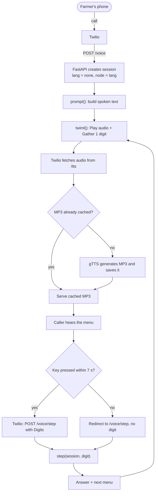

# 🌾 Kisan Voice

**One number. Any phone. Your language.**

A voice-first information helpline prototype for farmers in Maharashtra. A farmer calls, picks Marathi, Hindi or English, and uses the keypad to hear market prices, government scheme summaries and a path to emotional support. No smartphone, no internet and no reading required.

> Built for an agriculture and rural-solutions hackathon. **All prices and scheme details are sample data**; verify before real-world use.

## The problem

Farmers make high-stakes decisions (when to sell, what to claim, where to seek help) with incomplete or late information. Much of it exists online, but it is locked behind smartphones, data plans, literacy and English-first interfaces.

## The solution

A phone call works on every handset. Kisan Voice answers it in the farmer's language and keeps the menus short and simple.

## Features

| Feature | What the caller gets |
|---|---|
| Language choice | Marathi, Hindi or English, chosen at the start of the call |
| Market prices | Sample mandi prices per quintal for onion, soybean, cotton and tur |
| Government schemes | Short spoken summaries of PM-Kisan, Namo Shetkari Mahasanman Nidhi, crop insurance and Kisan Credit Card |
| Wellbeing support | Referral to the free Tele-MANAS helpline (14416) and a short calming message |
| Easy navigation | 9 repeats the menu, 0 goes back; every prompt is short |
| Browser simulator | Dialpad demo that runs the same logic without telephony |

## Demo

- Video: _add link_
- Screenshots: _add images_

## How it works

1. Twilio receives the call and sends a request to `/voice`.
2. The server creates a session and replies with TwiML: play the menu audio, then wait for one keypress.
3. Audio is generated by gTTS and cached on first use.
4. Each keypress goes to `/voice/step`, where `step()` moves the caller through the menus or returns an answer.

The menu logic in `step()` is separate from the telephony code, so it can be tested in the browser simulator and moved to another provider with little change.

## Tech stack

Python, FastAPI, Uvicorn, gTTS, Twilio Voice (TwiML), ngrok, plain HTML/CSS/JavaScript.

## Project structure

    kisan-voice/
      main.py                  # menu logic, Twilio webhooks, audio endpoint, simulator API
      data.py                  # spoken text in 3 languages, mock crops, mandis, prices
      call_me.py               # places an outbound demo call via Twilio
      static/simulator.html    # browser dialpad simulator
      NOTES.md                 # libraries, flowcharts, commands
      requirements.txt

## Getting started

### 1. Run locally with the simulator

    python -m venv venv
    venv\Scripts\activate            # macOS/Linux: source venv/bin/activate
    pip install -r requirements.txt
    uvicorn main:app --reload

Open http://localhost:8000, press **Call**, and use the dialpad. gTTS needs an internet connection to create audio.

> PowerShell blocks activation? Run `Set-ExecutionPolicy -Scope CurrentUser -ExecutionPolicy RemoteSigned` once.

### 2. Try a real phone call (optional)

1. Create a Twilio account, verify your phone number and get a Twilio number with Voice capability.
2. If calling India, enable India under Voice Geo Permissions.
3. Run `ngrok http 8000` and copy the https address.
4. Set the address and restart the server (PowerShell):

       $env:BASE_URL="https://YOUR-ADDRESS.ngrok-free.app"
       uvicorn main:app --reload

5. In a second terminal, set the variables below and run `python call_me.py`. Your phone rings and the menu plays.

To receive calls instead, set the number's *A call comes in* webhook to `https://YOUR-ADDRESS.ngrok-free.app/voice` (HTTP POST).

## Configuration

| Variable | Meaning |
|---|---|
| `BASE_URL` | Public ngrok address, no trailing slash |
| `TWILIO_SID`, `TWILIO_TOKEN` | Twilio credentials (never commit these) |
| `TWILIO_TO`, `TWILIO_FROM` | Your verified phone and your Twilio number |

## Customize

Edit `data.py` to change spoken text, crops, mandis, prices or schemes. Edit `step()` in `main.py` to change menu behavior.

## Limitations

- Prices and scheme text are mock data.
- Sessions are kept in memory and reset when the server restarts.
- Speech is machine-generated and needs review by native speakers.
- Twilio trial accounts only call verified numbers and play a short announcement.
- Keypad input only; no speech recognition yet.
- The wellbeing menu only refers callers to professional help and does not replace counseling.

## Roadmap

- Real data from Agmarknet, e-NAM and official scheme portals
- Toll-free number through an Indian telecom provider and a missed-call-to-callback flow
- SMS summaries after each lookup
- Caller memory (language, crop, district)
- Scheme eligibility questions
- More languages and dialects, then voice input
- Equipment and vendor directory

## Author

Forkion-69 · _https://www.linkedin.com/in/kartik-tambe-234b2a442/_

## License

_Choose a license (for example MIT) and add a LICENSE file._
